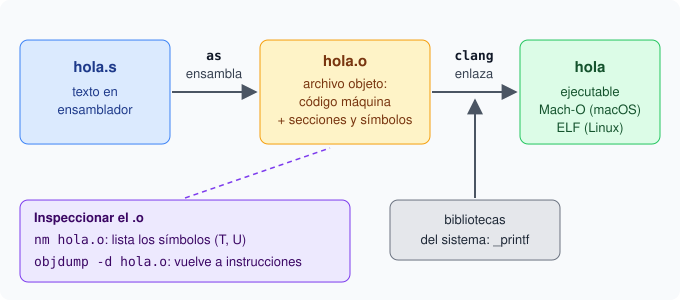

# 1. Del código fuente al ejecutable

## El viaje de un archivo `.s`

Un programa en ensamblador empieza siendo texto. Es un archivo `.s` con líneas como `add x0, x0, x1`. Ese texto todavía no se puede ejecutar. Para ejecutarlo pasa por dos pasos:

1. El ensamblador `as` traduce las instrucciones a código máquina. El resultado es un archivo objeto con extensión `.o`.
2. El enlazador (linker) junta los archivos objeto y escribe el ejecutable.

El build completo en macOS es este:

```bash
as f.s -o f.o && clang f.o -o f && ./f
```

El primer comando crea `f.o`. El segundo crea `f`, el programa ejecutable. El tercero lo ejecuta.



En la imagen, `nm` y `objdump -d` no cambian nada: solo leen el `.o` para inspeccionarlo.

## Qué hace `as`

`as` es el ensamblador. Recibe un archivo `.s` y escribe un archivo `.o` con las instrucciones ya convertidas a bytes. Esa traducción es literal: cada mnemónico se convierte en sus bytes. `as` no busca bibliotecas ni llama a C. Solo traduce un archivo. El `.o` tiene código máquina, pero todavía no es un programa: falta el segundo paso.

## Qué hace el enlazador

El enlazador une varios `.o` en un solo ejecutable. Para eso hace tres trabajos:

1. Coloca las secciones de cada `.o` en su sitio dentro del programa.
2. Resuelve los símbolos: si un `.o` usa una función que define otro `.o`, el enlazador une ambas partes.
3. Escribe el ejecutable final en el formato del sistema (Mach-O en macOS, ELF en Linux).

Si un símbolo se usa pero nadie lo define, el enlazador detiene el proceso con un error de enlace.

## Secciones de un archivo objeto

Un `.o` agrupa su contenido en secciones. Las tres habituales son:

- **texto**: el código de las instrucciones.
- **datos**: las variables con un valor inicial escrito en el código.
- **.bss**: las variables declaradas sin inicializar.

La pila de ejecución no es una sección del archivo. La pila se crea cuando el programa corre.

## Símbolos y `nm`

Un símbolo es el nombre de una función o variable. La herramienta `nm` lista los símbolos de un archivo. Cada línea muestra una dirección, una letra y el nombre. Las letras importantes son:

- `T`: el símbolo está definido en la sección de texto (código) y es global.
- `U`: el símbolo se usa, pero no está definido en este archivo.

Por ejemplo, `nm suma.o` puede mostrar `T _suma` (la función está aquí) y `U _printf` (falta definirla, la aporta el enlazador).

## Desensamblar con `objdump -d`

`objdump -d` hace el proceso inverso de `as`. Lee el código máquina del `.o` y lo muestra otra vez como instrucciones. Es la herramienta clásica para ver qué contiene un binario cuando ya no tienes el archivo `.s`.

## Guion bajo: Mach-O frente a ELF

En macOS el formato de los binarios se llama Mach-O. En Linux se llama ELF. Hay una diferencia visible: en Mach-O los símbolos de funciones llevan un guion bajo al principio. La función `suma` se escribe `_suma`. En ELF el mismo símbolo aparece como `suma`, sin guion. Por eso los ejercicios de este curso escriben `.globl _suma` y no `.globl suma`.

## Qué vas a practicar

En los ejercicios de este capítulo vas a:

1. Escribir un programa completo y pasarlo por los dos pasos: `as` y el enlazador.
2. Ejecutar el build completo `as f.s -o f.o && clang f.o -o f && ./f`.
3. Usar `nm` para leer los símbolos de un `.o` y reconocer las letras `T` y `U`.
4. Comprobar el guion bajo de Mach-O en los nombres de función.
