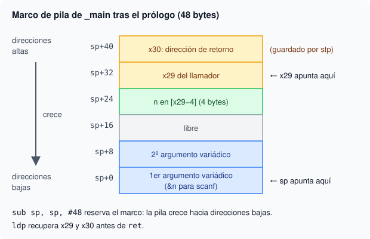

# 3. Tu primer programa en ARM64

## Objetivo

En este capítulo vas a escribir un programa completo en ensamblador AArch64 para macOS. Vas a conocer los registros, el prólogo y el epílogo, y las llamadas a `printf` y `scanf`.

## Los registros de AArch64

AArch64 tiene 31 registros enteros de 64 bits, llamados `x0` a `x30`. Cada registro tiene además una vista de 32 bits llamada `w`. Por ejemplo, `w0` son los 32 bits bajos de `x0`. Si escribes en `w1`, la parte alta de `x1` se pone a cero.

Los registros tienen funciones fijas:

- `x0` a `x7`: argumentos de una función normal y también el valor de retorno.
- `x29`: puntero del marco de pila (frame pointer).
- `x30`: registro de enlace (link register). Guarda la dirección a la que hay que volver.
- `sp`: puntero de pila. La pila crece hacia direcciones más bajas.
- `xzr`: registro cero. Leerlo siempre da 0.

## Volátiles y callee-saved

Después de una llamada, unos registros conservan su valor y otros no:

- **Volátiles** (`x0` a `x18`): la función llamada puede modificarlos sin avisar. No confíes en su valor después de un `bl`.
- **callee-saved** (`x19` a `x28`, más `x29` y `x30`): si los modificas, debes guardarlos y restaurarlos tú. Son los que cada función se ocupa de conservar.

## Prólogo y epílogo

`bl _printf` salta a `printf` y escribe en `x30` la dirección de la instrucción siguiente. Si `_main` llama a `_printf`, `x30` deja de contener la dirección de retorno del propio programa. Cuando la función ejecute `ret`, saltará a una dirección inválida y el programa se colgará. Por eso se guarda `x30` al principio y se restaura al final:

```asm
_main:
    sub sp, sp, #48
    stp x29, x30, [sp, #32]
    add x29, sp, #32
    // ... cuerpo del programa ...
    mov w0, #0
    ldp x29, x30, [sp, #32]
    add sp, sp, #48
    ret
```

`stp` guarda dos registros de una vez y `ldp` los restaura. `add x29, sp, #32` deja `x29` apuntando a los dos valores guardados. `mov w0, #0` devuelve el código de salida 0 al sistema.



La imagen muestra los 48 bytes que reserva el prólogo del programa de la sección siguiente. Las direcciones altas están arriba. `sp` apunta a la parte baja del marco y `x29`, a los dos registros guardados.

## Etiquetas

Una etiqueta es un nombre que marca una posición, como `fin:`. Se usa para saltar con `b` o con `b.ne`, que salta si las dos últimas comparadas con `cmp` no son iguales. Los dos puntos van solo al definir la etiqueta; al saltar a ella no se escriben.

## adrp y add: la dirección de un string

No se pueden escribir direcciones absolutas a mano. Para cargar la dirección de un string se usa un par de instrucciones:

```asm
adrp x0, saludo@PAGE
add x0, x0, saludo@PAGEOFF
```

`adrp` carga la dirección de la página y `add` suma el desplazamiento dentro de esa página. Juntas dejan en `x0` la dirección del string.

## printf y scanf en macOS

Una función normal recibe sus argumentos en `x0`, `x1`, `x2`… y devuelve el resultado en `x0`. Pero `printf` y `scanf` son variadicas: aceptan un número variable de argumentos. En macOS con chip Apple, esos argumentos van en la pila, en `[sp+0]`, `[sp+8]`, `[sp+16]`… con 8 bytes cada uno. El puntero al formato es lo único que va en `x0`.

Este programa lee un entero y escribe su doble:

```asm
.globl _main
_main:
    sub sp, sp, #48
    stp x29, x30, [sp, #32]
    add x29, sp, #32
    // scanf("%d", &n): n vive en [x29-4]; &n va a [sp+0]
    sub x8, x29, #4
    str x8, [sp]
    adrp x0, fmt1@PAGE
    add x0, x0, fmt1@PAGEOFF
    bl _scanf
    cmp w0, #1
    b.ne fin
    ldur w8, [x29, #-4]
    add w8, w8, w8
    str w8, [sp]
    adrp x0, fmt2@PAGE
    add x0, x0, fmt2@PAGEOFF
    bl _printf
fin:
    mov w0, #0
    ldp x29, x30, [sp, #32]
    add sp, sp, #48
    ret

.data
fmt1: .asciz "%d"
fmt2: .asciz "doble=%d\n"
```

`sub x8, x29, #4` calcula la dirección de `n` y `str x8, [sp]` la deja en el primer hueco de la pila. `scanf` devuelve en `w0` el número de elementos leídos; `cmp w0, #1` más `b.ne fin` comprueban que el dato era válido. Para imprimir, `str w8, [sp]` deja el resultado en la pila y `x0` lleva el formato. Fíjate en que el `\n` va dentro del propio string.

## Qué vas a practicar

En los ejercicios de este capítulo vas a:

1. Escribir un programa completo con prólogo y epílogo.
2. Leer un entero con `scanf`, pasando la dirección de la variable por la pila.
3. Comprobar el valor que devuelve `scanf` antes de usar el dato.
4. Leer dos enteros con un solo `scanf` y sumarlos en ensamblador.
