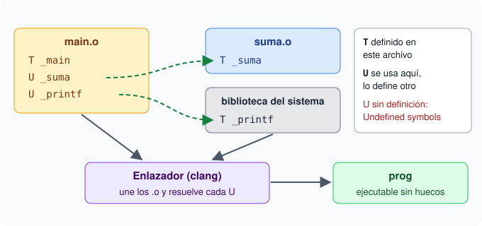

# 5. El enlazador y las bibliotecas

## Objetivo

Al terminar este capítulo sabrás qué hace el enlazador, cómo leer la tabla de símbolos de un `.o`, qué significan los errores `Undefined symbols` y `duplicate symbol`, y cómo crear y usar una biblioteca estática.

## Qué hace el enlazador

El ensamblador (`as`) transforma tu `.s` en un archivo objeto (`.o`). Un `.o` casi es un programa, pero tiene huecos: las llamadas a funciones de otros archivos no apuntan todavía a ningún sitio.

El **enlazador** es el programa que cierra esos huecos. Hace tres trabajos:

1. Une todos los `.o` que le indiques en un solo archivo.
2. Asigna una dirección de memoria a cada trozo de código y de datos.
3. Sustituye cada referencia externa por la dirección real del símbolo.

En macOS casi no se invoca a mano. Se usa `clang`, que compila, enlaza y añade las bibliotecas del sistema en un solo paso:

```bash
clang main.o suma.o -o prog
```

## Símbolos definidos y externos

Cada `.o` lleva su **tabla de símbolos**: la lista de nombres que el archivo define y de nombres que usa. La enseña `nm`:

```bash
nm suma.o
```

Cada línea tiene una dirección, un tipo y el nombre. Los tres tipos que usarás son:

- `T`: el símbolo está **definido** en la sección de texto. Es el código de una función.
- `U`: el símbolo es **externo**. Alguien lo usa y nadie lo define en este archivo.
- `D`: el símbolo está definido en la sección de datos.

En macOS los nombres C llevan un guion bajo. La función `suma` aparece como `_suma`.

Si en tu `.o` aparece `U _printf`, tu código llama a `printf` y otra pieza tendrá que definirla al enlazar.



Cada `U` de `main.o` tiene que encontrar una `T` en otra pieza. Si alguna no la encuentra, aparece el error de la sección siguiente.

## El error Undefined symbols

Cuando el enlazador termina y queda alguna referencia sin resolver, el mensaje es este:

```
Undefined symbols for architecture arm64:
  "_no_existe", referenced from:
      _main in m.o
```

Hay dos motivos posibles:

1. No pasaste el `.o` que define ese símbolo.
2. La definición vive en una biblioteca y no indicaste cuál.

El símbolo que falta aparece entre comillas y con su guion bajo. Ese nombre es la primera pista.

## El error duplicate symbol

El otro error típico es el contrario: dos definiciones del mismo símbolo.

```
duplicate symbol '_dup' in:
    a.o
    b.o
```

El enlazador no sabe cuál de las dos usar, así que se niega a continuar. La solución es borrar una de las dos definiciones o separarlas en piezas que no se enlacen a la vez.

## Bibliotecas estáticas con ar

Una **biblioteca estática** es un archivo `.a` que junta uno o varios `.o`. Se crea con `ar`:

```bash
ar rcs libsuma.a suma.o
```

- `r` inserta el `.o` en la biblioteca y la crea si no existía.
- `c` no avisa de que el archivo es nuevo.
- `s` escribe el índice de símbolos, para que el enlazador la consulte rápido.

Puedes meter varios `.o` en la misma biblioteca. `nm libsuma.a` enseña la cabecera de cada miembro y sus símbolos.

## Enlazar contra una biblioteca

Para usar `-l`, el archivo debe llamarse `lib` más el nombre más `.a`, y hay que decirle al enlazador dónde buscarlo:

```bash
clang main.o -L. -lsuma -o prog
```

- `-L.` añade el directorio actual a la ruta de búsqueda.
- `-lsuma` busca `libsuma.a` (o `libsuma.dylib`) en esa ruta.

Si olvidas `-L.`, el enlazador no encuentra tu biblioteca y verás otra vez `Undefined symbols`.

## En GNU/Linux

El flujo es el mismo, con cuatro detalles distintos:

- El binario final es **ELF**; en macOS es **Mach-O**.
- Los símbolos C no llevan guion bajo: la función es `suma`, no `_suma`.
- El enlazador `ld` se puede invocar a mano, aunque lo habitual es dejar que `gcc` o `clang` lo llamen.
- Las funciones matemáticas viven en `libm`, así que hay que añadir `-lm` al final: `gcc main.o suma.o -lm -o prog`.

En los dos sistemas: `ar` crea bibliotecas, `nm` enseña símbolos y `-L` más `-l` enlazan.

## Qué vas a practicar

- Empaquetar un `.o` en una biblioteca estática con `ar rcs`.
- Enlazar contra esa biblioteca con `-L.` y `-l`, y leer el resultado con `nm`.
- Capturar e interpretar los errores `Undefined symbols` y `duplicate symbol`.
