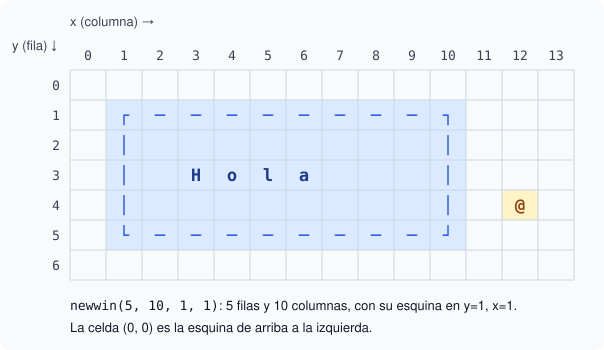

# 1. Tu primera interfaz de texto con ncurses

## Objetivo

Al terminar este capítulo sabrás abrir y cerrar una pantalla de ncurses, escribir en una posición concreta, crear ventanas con borde y leer el teclado tecla a tecla.

## Qué es ncurses

ncurses es una biblioteca de C para dibujar interfaces dentro de la terminal. Con ella puedes escribir en cualquier punto de la pantalla, dibujar marcos y reaccionar a cada tecla sin esperar a Enter. Editores como `nano` y herramientas como `htop` la usan.

Se incluye con `#include <ncurses.h>` y se enlaza con `-lncurses`:

```bash
gcc programa.c -lncurses -o programa
```

## Abrir y cerrar la pantalla

Todo programa de ncurses tiene la misma estructura:

```c
initscr();      // abre la pantalla de ncurses
// … dibujar y leer teclas …
endwin();       // devuelve la terminal a su estado normal
```

Si el programa termina sin `endwin()`, la terminal queda desconfigurada: no se ve lo que escribes. Si te pasa, escribe `reset` y pulsa Enter.

## La pantalla es una rejilla

La pantalla es una rejilla de celdas. Cada celda guarda un carácter. La celda `(0, 0)` es la esquina de arriba a la izquierda.

**Regla importante:** en ncurses la fila (`y`) va siempre **antes** que la columna (`x`). Es al revés que en matemáticas.



En la imagen, la palabra `Hola` empieza en la fila 3, columna 3 de la pantalla.

## Escribir en una posición

Las funciones que empiezan por `mv` mueven el cursor y después escriben:

```c
mvprintw(3, 3, "Hola");     // texto con formato, como printf
mvaddch(0, 0, '#');         // un solo carácter
refresh();                  // muestra los cambios
```

ncurses no dibuja en cuanto llamas a `mvprintw`. Primero apunta los cambios en una copia de la pantalla en memoria. `refresh()` compara esa copia con la terminal y envía solo lo que cambió. **Sin `refresh()` no ves nada.**

## Ventanas

Una ventana es un rectángulo con sus propias coordenadas. Se crea con `newwin(filas, columnas, y, x)`:

```c
WINDOW *ventana = newwin(5, 10, 1, 1);
box(ventana, 0, 0);                    // borde con los caracteres por defecto
mvwprintw(ventana, 2, 2, "Hola");      // fila 2, columna 2 DE LA VENTANA
wrefresh(ventana);                     // muestra los cambios de esta ventana
```

- Las funciones de ventana llevan una `w`: `mvwprintw`, `wrefresh`.
- Las coordenadas son relativas a la esquina de la ventana. Por eso `(2, 2)` de la ventana es `(3, 3)` en la pantalla.
- Cuando ya no la necesitas, libérala con `delwin(ventana)`.

## Leer el teclado

Tres ajustes son habituales justo después de abrir la pantalla:

```c
cbreak();               // cada tecla llega al momento, sin esperar a Enter
noecho();               // las teclas pulsadas no se escriben solas en pantalla
keypad(stdscr, TRUE);   // las flechas llegan como KEY_UP, KEY_DOWN…
```

`getch()` espera una tecla y la devuelve como `int`. Si no hay más entrada, devuelve `ERR`. Un bucle típico de juego:

```c
int tecla;
while ((tecla = getch()) != 'q' && tecla != ERR) {
    // mover, dibujar, refresh()
}
```

## Cómo se prueban los ejercicios

Las pruebas no tienen una terminal real. Por eso el andamiaje de los ejercicios abre la pantalla con `newterm(NULL, stderr, stdin)` en lugar de `initscr()`. Hace lo mismo, pero dibuja en la salida de errores. Al terminar, el andamiaje lee lo que quedó en la pantalla y lo imprime como texto normal. Las pruebas comparan ese texto.

Cada ejercicio es un script `.sh`: escribe el programa en C, lo compila con `-lncurses` y lo ejecuta. Edita solo la función marcada con `TODO`.

## Qué vas a practicar

- Crear una ventana con `newwin`, dibujar su borde con `box` y escribir dentro con `mvwprintw`.
- Leer teclas con `getch` hasta `q` o `ERR`.
- Mover un carácter por la rejilla sin salir de sus límites, con la fila antes que la columna.
