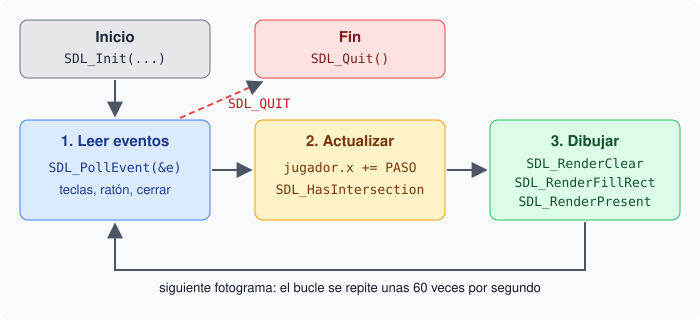
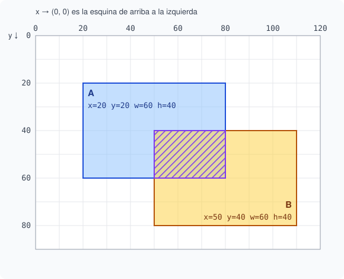

# 1. SDL2: ventana, bucle de juego y choques

## Objetivo

Al terminar este capítulo sabrás cómo es un programa de SDL2: abrir una ventana, dibujar rectángulos, escribir el bucle de juego con sus eventos y detectar choques entre rectángulos.

## Qué es SDL

SDL (Simple DirectMedia Layer) es una biblioteca de C para hacer juegos y programas multimedia. Abre ventanas, dibuja, lee el teclado y el ratón y reproduce sonido. Funciona igual en macOS, Linux y Windows.

Se incluye con `#include <SDL.h>`. Para compilar, `sdl2-config` da las opciones correctas para tu sistema:

```bash
gcc juego.c $(sdl2-config --cflags --libs) -o juego
```

En algunos sistemas SDL sustituye a `main` por su propia función. Por eso `main` debe tener la forma completa: `int main(int argc, char *argv[])`.

## Iniciar, abrir una ventana y cerrar

```c
SDL_Init(SDL_INIT_VIDEO);
SDL_Window *ventana = SDL_CreateWindow("Mi juego",
    SDL_WINDOWPOS_CENTERED, SDL_WINDOWPOS_CENTERED, 640, 480, 0);
SDL_Renderer *pincel = SDL_CreateRenderer(ventana, -1, 0);
// … bucle de juego …
SDL_DestroyRenderer(pincel);
SDL_DestroyWindow(ventana);
SDL_Quit();
```

- `SDL_Init` arranca las partes de SDL que pides. `SDL_INIT_VIDEO` es la de la ventana.
- `SDL_CreateWindow` recibe el título, la posición, el ancho y el alto en píxeles.
- El **renderer** es el objeto que dibuja dentro de la ventana.
- Todo lo que creas se destruye al final, en orden inverso. `SDL_Quit` cierra SDL.

## Coordenadas y rectángulos

La ventana es una rejilla de píxeles. El píxel `(0, 0)` es la esquina de arriba a la izquierda. `x` crece hacia la derecha e `y` crece **hacia abajo**.

Un `SDL_Rect` describe un rectángulo con cuatro enteros: `x` e `y` de la esquina de arriba a la izquierda, y su ancho `w` y alto `h`.

```c
SDL_Rect jugador = { 100, 100, 20, 20 };   // x, y, w, h
```

## Dibujar un fotograma

Cada fotograma se dibuja entero, en cuatro pasos:

```c
SDL_SetRenderDrawColor(pincel, 0, 0, 0, 255);      // color: negro
SDL_RenderClear(pincel);                           // 1. borra todo con ese color
SDL_SetRenderDrawColor(pincel, 255, 0, 0, 255);    // color: rojo
SDL_RenderFillRect(pincel, &jugador);              // 2. dibuja el jugador
SDL_RenderPresent(pincel);                         // 3. muestra el fotograma
```

SDL dibuja en una imagen oculta. `SDL_RenderPresent` la muestra de golpe en la ventana. Así no se ve el dibujo a medias.

## El bucle de juego

Un juego repite tres fases muchas veces por segundo:

1. **Leer eventos:** qué teclas se pulsaron, si se cerró la ventana.
2. **Actualizar:** mover objetos y comprobar choques.
3. **Dibujar:** pintar el fotograma nuevo.



## Eventos

SDL guarda los eventos en una **cola**. `SDL_PollEvent` saca el siguiente y devuelve 0 cuando la cola está vacía. Como en un fotograma pueden llegar varios, se lee con un `while`:

```c
SDL_Event e;
while (SDL_PollEvent(&e)) {
    if (e.type == SDL_QUIT) corriendo = 0;               // se cerró la ventana
    if (e.type == SDL_KEYDOWN && e.key.keysym.sym == SDLK_RIGHT)
        jugador.x += 10;                                 // flecha derecha
}
```

- `e.type` dice qué tipo de evento es: `SDL_QUIT`, `SDL_KEYDOWN`, `SDL_MOUSEBUTTONDOWN`…
- En un `SDL_KEYDOWN`, `e.key.keysym.sym` dice qué tecla: `SDLK_UP`, `SDLK_DOWN`, `SDLK_LEFT`, `SDLK_RIGHT`, `SDLK_SPACE`…

## Choques entre rectángulos

Para saber si dos objetos chocan, se comprueba si sus rectángulos se solapan:

```c
if (SDL_HasIntersection(&jugador, &muro)) {
    SDL_Rect comun;
    SDL_IntersectRect(&jugador, &muro, &comun);   // la zona que comparten
}
```



Un rectángulo ocupa desde `x` hasta `x + w - 1`. Por eso dos rectángulos que solo se tocan por el borde, como `{0, 0, 10, 10}` y `{10, 0, 10, 10}`, **no** se solapan.

## Cómo se prueban los ejercicios

Las pruebas no tienen pantalla. Por eso los ejercicios usan solo las partes de SDL que no la necesitan: rectángulos y eventos. En el ejercicio del bucle, el andamiaje convierte las letras de la entrada en pulsaciones de teclas con `SDL_PushEvent`, igual que si las pulsaras tú.

Cada ejercicio es un script `.sh`: escribe el programa en C, lo compila con `sdl2-config` y lo ejecuta. Edita solo la parte marcada con `TODO`.

## Qué vas a practicar

- Detectar choques con `SDL_HasIntersection` y calcular la zona común con `SDL_IntersectRect`.
- Escribir la fase de eventos del bucle de juego con `SDL_PollEvent`, `SDL_QUIT` y `SDL_KEYDOWN`.
- Recordar que en SDL el eje y crece hacia abajo.
